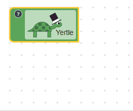

# 字段解析

## 值

所有字段都必须有一个值，它是字段数据的真实来源。值可以是任意类型（字符串、数字、数组、日期等）。字段可以通过校验器限制可接受的值，或把值转换为机器可读格式（例如规范化日期格式）。

## 文本

所有字段都包含文本，它是字段值的人类可读字符串表示。这不意味着文本和字段值一定相同。例如，布尔字段的文本可能是“开”或“关”，而其值是 `true` 或 `false`。

该文本会在块折叠时显示，也会用于无障碍读取，并且可选地作为[块上显示](#块上显示)的一部分。

## 可编辑字段与不可编辑字段

通常，可编辑字段允许用户改变代码行为，不可编辑字段主要用于向用户展示块的信息。点击可编辑字段时，可能会出现复杂编辑器。

可编辑字段包括：

- [复选框](/guides/create-custom-blocks/fields/built-in-fields/checkbox)
- [颜色](/guides/create-custom-blocks/fields/built-in-fields/colour)
- [下拉菜单](/guides/create-custom-blocks/fields/built-in-fields/dropdown)
- [数字](/guides/create-custom-blocks/fields/built-in-fields/number)
- [文本输入](/guides/create-custom-blocks/fields/built-in-fields/text-input)

不可编辑字段包括：

- [标签](/guides/create-custom-blocks/fields/built-in-fields/label)
- [可序列化标签](/guides/create-custom-blocks/fields/built-in-fields/label-serializable)
- [图片](/guides/create-custom-blocks/fields/built-in-fields/image)

## 序列化

可序列化字段的值会编码进保存格式（JSON 或 XML）。所有可编辑字段都可序列化，因为它们的值是动态的。不可编辑字段的值通常不是动态值，因此通常不会被序列化。

可序列化字段包括：

- [复选框](/guides/create-custom-blocks/fields/built-in-fields/checkbox)
- [颜色](/guides/create-custom-blocks/fields/built-in-fields/colour)
- [下拉菜单](/guides/create-custom-blocks/fields/built-in-fields/dropdown)
- [数字](/guides/create-custom-blocks/fields/built-in-fields/number)
- [文本输入](/guides/create-custom-blocks/fields/built-in-fields/text-input)
- [可序列化标签](/guides/create-custom-blocks/fields/built-in-fields/label-serializable)

不可序列化字段包括：

- [标签](/guides/create-custom-blocks/fields/built-in-fields/label)
- [图片](/guides/create-custom-blocks/fields/built-in-fields/image)

注意，可序列化标签虽然不可编辑，但可序列化。这意味着它只能通过编程方式修改，而不是通过用户可见界面修改。修改后，其值会编码进生成的 JSON/XML。

## 代码生成

除了连接和断开块，字段是用户控制 Blockly 生成代码的主要方式。字段提供的编辑器允许用户修改字段存储的值，随后块的生成器可读取该值并用于生成代码。

关于在生成器中使用字段值，见[块代码生成器中的获取字段值](/guides/create-custom-blocks/code-generation/block-code#获取字段值)。

## 块上显示

字段的块上显示是用于表现字段值的一组 SVG 元素。它们会占用块上的空间，尺寸变化时会推动块本身重排。根据需要，字段的块上显示可以很简单，也可以很复杂。

下面是按复杂度递增的块上显示示例：

| 字段类型 | 描述 |
| --- | --- |
| 标签 | 只包含一个文本元素。 |
| 角度 | 包含背景矩形、文本元素和度数符号。 |
| 龟 | 包含背景矩形、文本元素，以及用于绘制海龟图形的多个 SVG 元素。 |

## 编辑器显示

当用户点击可编辑字段时，该字段可能显示任意复杂度的编辑器。

下面是按复杂度递增的编辑器示例：

| 字段类型 | 描述 |
| --- | --- |
| 复选框 | 点击时没有独立编辑器，块上显示会直接更新。 |
| 数字输入 | 在块上显示上方叠加文本编辑器。用户可直接输入，编辑器可能通过颜色提示无效值。 |
| 角度选择器 | 同时提供数字输入编辑器和用于可视化选角度的拖拽编辑器。 |

## 其他显示模式

折叠模式：用户折叠块后，块会使用各字段返回的文本来展示值的文本表示。

无障碍模式：用户可能通过屏幕阅读器或类似技术与 Blockly 交互，字段文本可被读出。
