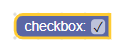
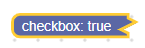
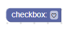
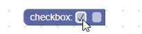

# 复选框字段

复选框字段会把值和文本都存为字符串。它的值是 `'TRUE'` 或 `'FALSE'`，文本是 `'true'` 或 `'false'`。

#### 复选框字段



#### 折叠块上的复选框字段



## 创建

::::tabs
::: tab JSON

```json
{
  "type": "example_checkbox",
  "message0": "checkbox: %1",
  "args0": [
    {
      "type": "field_checkbox",
      "name": "FIELDNAME",
      "checked": true
    }
  ]
}
```

:::
::: tab JavaScript

```javascript
Blockly.Blocks['example_checkbox'] = {
  init: function() {
    this.appendDummyInput()
        .appendField('checkbox:')
        .appendField(new Blockly.FieldCheckbox(true), 'FIELDNAME');
  }
};
```

:::
::::

复选框构造函数接收一个可选值和一个可选[校验器](#创建复选框校验器)。可选值应为 `'TRUE'`、`'FALSE'` 或布尔值，否则默认值为 `false`。

## 序列化

::::tabs
::: tab JSON
复选框字段的 JSON 如下：

```json
{
  "fields": {
    "FIELDNAME": true
  }
}
```

其中 `FIELDNAME` 是引用复选框字段的字符串，值是应用到该字段的值。这里的值必须是布尔值。

:::
::: tab XML
复选框字段的 XML 如下：

```xml
<field name="FIELDNAME">TRUE</field>
```

或

```xml
<field name="FIELDNAME">true</field>
```

::: tip 提示
内部文本不需要加引号。
:::

其中 `name` 属性是引用复选框字段的字符串，内部文本是应用到该字段的值。内部文本值遵循与构造函数值相同的规则。

注意，反序列化再序列化后，所有内部文本会统一为大写（`'TRUE'` 或 `'FALSE'`）。在对工作区做差异比较时，这一点有时很重要。

:::
::::

## 自定义

### 对勾字符

`Blockly.FieldCheckbox.CHECK_CHAR` 属性可用于修改对勾字符显示。该值应为包含 Unicode 字符的字符串。



`CHECK_CHAR` 默认值是 `\u2713`，也就是 ✓。

这是全局属性，设置后会影响所有复选框字段。

## 创建复选框校验器

::: tip 提示
校验器通用规则见[校验器](/guides/create-custom-blocks/fields/validators)。
:::

复选框字段的值是 `'TRUE'` 或 `'FALSE'`，所以校验器应接收这两种字符串，并返回 `'TRUE'`、`'FALSE'`、`null` 或 `undefined`。

::: warning 注意
不要在校验器内部使用 `getValueBoolean`，因为它返回的是当前值，而不是新值。
:::

下面示例校验器会根据复选框是否勾选来显示或隐藏文本输入字段：

```javascript
validate: function(newValue) {
  var sourceBlock = this.getSourceBlock();
  sourceBlock.showTextField_ = newValue == 'TRUE';
  sourceBlock.updateTextField();

  return newValue;
},

updateTextField: function() {
  var input = this.getInput('DUMMY');
  if (this.showTextField_ && !this.getField('TEXT')) {
    input.appendField(new Blockly.FieldTextInput(), 'TEXT');
  } else if (!this.showTextField_ && this.getField('TEXT')) {
    input.removeField('TEXT');
  }
}
```

#### 带校验器的复选框字段


