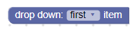
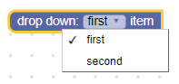
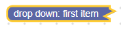
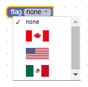
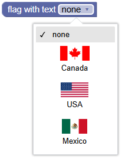
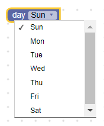
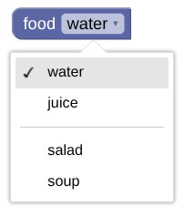
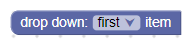
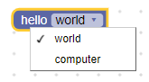
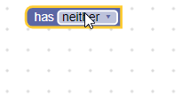

# 下拉菜单字段

下拉菜单字段把值和文本都存为字符串。值是语言无关键，用于读取对应文本；当 Blockly 在不同语言间切换时，这个值不会被翻译。文本是展示给用户的人类可读字符串。

#### 下拉菜单字段



#### 打开编辑器的下拉菜单字段



#### 折叠块上的下拉菜单字段



## 创建

下拉菜单构造函数接收一个菜单生成器和一个可选[校验器](#创建下拉菜单校验器)。菜单生成器可以是选项数组（每个选项包含可读部分和语言无关字符串），也可以是返回选项数组的函数。选项的可读部分可以是字符串、图片或 HTML 元素，并且可在同一数组中混用。

### 简单文本下拉菜单


::::tabs
::: tab JSON

```json
{
  "type": "example_dropdown",
  "message0": "drop down: %1",
  "args0": [
    {
      "type": "field_dropdown",
      "name": "FIELDNAME",
      "options": [
        ["first item", "ITEM1"],
        ["second item", "ITEM2"]
      ]
    }
  ]
}
```

:::
::: tab JavaScript

```javascript
Blockly.Blocks['example_dropdown'] = {
  init: function() {
    this.appendDummyInput()
        .appendField('drop down:')
        .appendField(new Blockly.FieldDropdown([
            ['first item', 'ITEM1'],
            ['second item', 'ITEM2']
        ]), 'FIELDNAME');
  }
};
```

:::
::::

把可读文本和语言无关键分开后，下拉菜单设置可以跨语言保持一致。例如同一个块，英文可定义 `[['left', 'LEFT'], ['right', 'RIGHT']]`，德文可定义 `[['links', 'LEFT'], ['rechts', 'RIGHT']]`。

### 图片下拉菜单

下拉菜单选项也可以是图片。图片选项通过 `src`、`width`、`height`、`alt` 属性描述。



::::tabs
::: tab JSON

```json
{
  "type": "image_dropdown",
  "message0": "flag %1",
  "args0": [
    {
      "type": "field_dropdown",
      "name": "FLAG",
      "options": [
        ["none", "NONE"],
        [
          { "src": "canada.png", "width": 50, "height": 25, "alt": "Canada" },
          "CANADA"
        ],
        [{ "src": "usa.png", "width": 50, "height": 25, "alt": "USA" }, "USA"],
        [
          { "src": "mexico.png", "width": 50, "height": 25, "alt": "Mexico" },
          "MEXICO"
        ]
      ]
    }
  ]
}
```

:::
::: tab JavaScript

```javascript
Blockly.Blocks['image_dropdown'] = {
  init: function() {
    var input = this.appendDummyInput()
        .appendField('flag');
    var options = [
      ['none', 'NONE'],
      [{src: 'canada.png', width: 50, height: 25, alt: 'Canada'}, 'CANADA'],
      [{src: 'usa.png', width: 50, height: 25, alt: 'USA'}, 'USA'],
      [{src: 'mexico.png', width: 50, height: 25, alt: 'Mexico'}, 'MEXICO']
    ];
    input.appendField(new Blockly.FieldDropdown(options), 'FLAG');
  }
};
```

:::
::::

### HTML 下拉菜单

选项也可以是任意 HTML 元素，但不能太大，也不应尝试处理鼠标或键盘事件。这个约束需要你自行遵守，Blockly 不会强制校验。

下拉打开时会展示 HTML 元素本体。下拉关闭且该项被选中时，会按优先级显示元素的 `title`、`aria-label` 或 `innerText`。



::::tabs
::: tab JSON

```json
{
  "type": "flags_with_text_dropdown",
  "message0": "flag with text %1",
  "args0": [
    {
      "type": "field_dropdown",
      "name": "FLAG_WITH_TEXT",
      "options": [
        ["x", "X"]
      ]
    }
  ],
  "extensions": ["flag_with_text_extension"]
}
```

```javascript
Blockly.Extensions.register('flag_with_text_extension',
  function() {
    function createFlagWithTextDiv(text, src) {
      const div = document.createElement('div');
      div.setAttribute('style', 'width: 75px;');
      div.setAttribute('title', text);
      const img = document.createElement('img');
      img.setAttribute('src', src);
      img.setAttribute('style', 'height: 25px; display: block; margin: auto;');
      div.appendChild(img);
      const para = document.createElement('p');
      para.innerText = text;
      para.setAttribute('style', 'text-align: center; margin: 5px;');
      div.appendChild(para);
      return div;
    }

    const canadaDiv = createFlagWithTextDiv('Canada', 'canada.png');
    const usaDiv = createFlagWithTextDiv('USA', 'usa.png');
    const mexicoDiv = createFlagWithTextDiv('Mexico', 'mexico.png');
    const options = [
      ['none', 'NONE'],
      [canadaDiv, 'CANADA'],
      [usaDiv, 'USA'],
      [mexicoDiv, 'MEXICO']
    ];
    this.getField('FLAG_WITH_TEXT').setOptions(options);
  });
```

这通过 JSON [扩展](/guides/create-custom-blocks/define/extensions)实现。

:::
::: tab JavaScript

```javascript
function createFlagWithTextDiv(text, src) {
  const div = document.createElement('div');
  div.setAttribute('style', 'width: 75px;');
  div.setAttribute('title', text);
  const img = document.createElement('img');
  img.setAttribute('src', src);
  img.setAttribute('style', 'height: 25px; display: block; margin: auto;');
  div.appendChild(img);
  const para = document.createElement('p');
  para.innerText = text;
  para.setAttribute('style', 'text-align: center; margin: 5px;');
  div.appendChild(para);
  return div;
}

const canadaDiv = createFlagWithTextDiv('Canada', 'canada.png');
const usaDiv = createFlagWithTextDiv('USA', 'usa.png');
const mexicoDiv = createFlagWithTextDiv('Mexico', 'mexico.png');

Blockly.Blocks['flags_with_text_dropdown'] = {
  init: function() {
    const input = this.appendDummyInput()
        .appendField('flag with text');
    const options = [
      ['none', 'NONE'],
      [canadaDiv, 'CANADA'],
      [usaDiv, 'USA'],
      [mexicoDiv, 'MEXICO']
    ];
    input.appendField(new Blockly.FieldDropdown(options), 'FLAG_WITH_TEXT');
  }
};
```

:::
::::

### 动态下拉菜单



::::tabs
::: tab JSON

```json
{
  "type": "dynamic_dropdown",
  "message0": "day %1",
  "args0": [
    {
      "type": "field_dropdown",
      "name": "DAY",
      "options": [
        ["x", "X"]
      ]
    }
  ],
  "extensions": ["dynamic_menu_extension"]
}
```

```javascript
Blockly.Extensions.register('dynamic_menu_extension',
  function() {
    this.getField('DAY').setOptions(function() {
      var options = [];
      var now = Date.now();
      for (var i = 0; i < 7; i++) {
        var dateString = String(new Date(now)).substring(0, 3);
        options.push([dateString, dateString.toUpperCase()]);
        now += 24 * 60 * 60 * 1000;
      }
      return options;
    });
  });
```

这通过 JSON [扩展](/guides/create-custom-blocks/define/extensions)实现。

:::
::: tab JavaScript

```javascript
Blockly.Blocks['dynamic_dropdown'] = {
  init: function() {
    var input = this.appendDummyInput()
      .appendField('day')
      .appendField(new Blockly.FieldDropdown(
        this.generateOptions), 'DAY');
  },

  generateOptions: function() {
    var options = [];
    var now = Date.now();
    for (var i = 0; i < 7; i++) {
      var dateString = String(new Date(now)).substring(0, 3);
      options.push([dateString, dateString.toUpperCase()]);
      now += 24 * 60 * 60 * 1000;
    }
    return options;
  }
};
```

:::
::::

下拉菜单也可以传入函数而非静态选项列表，使选项动态生成。该函数应返回与静态选项相同格式的数组：`[可读值, 语言无关键]`。每次点击下拉菜单都会重新执行函数并重新计算选项。

::: tip 提示
动态下拉菜单不会触发[前缀/后缀匹配](#前缀后缀匹配)。
:::

### 分隔线

在选项数组中使用字符串 `'separator'`，可以在下拉菜单项之间添加分隔线。



::::tabs
::: tab JSON

```json
{
  "type": "separator_dropdown",
  "message0": "food %1",
  "args0": [
    {
      "type": "field_dropdown",
      "name": "FOOD",
      "options": [
        ["water", "WATER"],
        ["juice", "JUICE"],
        "separator",
        ["salad", "SALAD"],
        ["soup", "SOUP"]
      ]
    }
  ]
}
```

:::
::: tab JavaScript

```javascript
Blockly.Blocks["separator_dropdown"] = {
  init: function() {
    var input = this.appendDummyInput()
        .appendField("food");
    var options = [
      ["water", "WATER"],
      ["juice", "JUICE"],
      "separator",
      ["salad", "SALAD"],
      ["soup", "SOUP"],
    ];
    input.appendField(new Blockly.FieldDropdown(options), "FOOD");
  }
};
```

:::
::::

## 序列化

::::tabs
::: tab JSON
下拉菜单字段的 JSON 如下：

```json
{
  "fields": {
    "FIELDNAME": "LANGUAGE-NEUTRAL-KEY"
  }
}
```

其中 `FIELDNAME` 是引用下拉菜单字段的字符串，值是应用到该字段的值。该值应为语言无关选项键。

:::
::: tab XML
下拉菜单字段的 XML 如下：

```xml
<field name="FIELDNAME">LANGUAGE-NEUTRAL-KEY</field>
```

其中字段的 `name` 属性是引用下拉菜单字段的字符串，内部文本是应用到该字段的值。内部文本应为有效的语言无关选项键。

:::
::::

## 自定义

### 下拉箭头

`Blockly.FieldDropdown.ARROW_CHAR` 属性可用于修改下拉箭头对应的 Unicode 字符。



`ARROW_CHAR` 默认值在 Android 上是 `\u25BC`（▼），其他平台是 `\u25BE`（▾）。

这是全局属性，设置后会影响所有下拉菜单字段。

### 菜单高度

`Blockly.FieldDropdown.MAX_MENU_HEIGHT_VH` 属性可用于修改菜单最大高度。它是相对于视口高度（浏览器窗口高度）的比例值。

`MAX_MENU_HEIGHT_VH` 默认值是 `0.45`。

这是全局属性，设置后会影响所有下拉菜单字段。

## 前缀/后缀匹配

如果下拉菜单选项共享相同前缀和/或后缀词，系统会自动提取这些公共词并作为静态文本展示。下面给出两个创建相同块的方式（第一个不使用后缀匹配，第二个使用后缀匹配）：

不使用后缀匹配：

::::tabs
::: tab JSON

```json
{
  "type": "dropdown_no_matching",
  "message0": "hello %1",
  "args0": [
    {
      "type": "field_dropdown",
      "name": "MODE",
      "options": [
        ["world", "WORLD"],
        ["computer", "CPU"]
      ]
    }
  ]
}
```

:::
::: tab JavaScript

```javascript
Blockly.Blocks['dropdown_no_matching'] = {
  init: function() {
    var options = [
      ['world', 'WORLD'],
      ['computer', 'CPU']
    ];

    this.appendDummyInput()
        .appendField('hello')
        .appendField(new Blockly.FieldDropdown(options), 'MODE');
  }
};
```

:::
::::

使用后缀匹配：

::::tabs
::: tab JSON

```json
{
  "type": "dropdown_with_matching",
  "message0": "%1",
  "args0": [
    {
      "type": "field_dropdown",
      "name": "MODE",
      "options": [
        ["hello world", "WORLD"],
        ["hello computer", "CPU"]
      ]
    }
  ]
}
```

:::
::: tab JavaScript

```javascript
Blockly.Blocks['dropdown_with_matching'] = {
  init: function() {
    var options = [
      ['hello world', 'WORLD'],
      ['hello computer', 'CPU']
    ];

    this.appendDummyInput()
        .appendField(new Blockly.FieldDropdown(options), 'MODE');
  }
};
```

:::
::::



这种写法的一个优点是更容易做多语言翻译。之前代码里有 `'hello'`、`'world'`、`'computer'` 三段独立词，而改写后是 `'hello world'` 和 `'hello computer'` 两个完整短语，翻译器更容易处理短语而不是孤立单词。

另一个优点是很多语言的词序和英语不同。假设某种语言写作 `'world hello'` 和 `'computer hello'`，后缀匹配算法会识别公共后缀 `'hello'`，并把它显示在下拉菜单后面。

但前缀/后缀匹配有时会失败。有些词组应该始终绑定在一起，前缀不应继续拆分。比如 `'drive red car'` 和 `'drive red truck'` 更合理的拆分是只提取 `'drive'`，而不是 `'drive red'`。可以把普通空格替换为 Unicode 不换行空格 `'\u00A0'` 来抑制匹配，因此可改写为 `'drive red\u00A0car'` 和 `'drive red\u00A0truck'`。

另一个失败场景是不用空格分词的语言，比如中文。字符串 `'訪問中國'` 表示 `'visit China'`，其中 `'中國'` 两个字符合起来才是 `'China'`。若被拆开，就会变成 `'centre'` 和 `'country'` 两个独立含义。要让前缀/后缀匹配在中文等语言中正常工作，只需在人为希望切分的位置插入空格。例如 `'訪問 中國'` 和 `'訪問 美國'` 会得到 `"visit [China/USA]"`，而 `'訪問 中 國'` 和 `'訪問 美 國'` 会得到 `"visit [centre/beautiful] country"`。

## 创建下拉菜单校验器

::: tip 提示
校验器通用规则见[校验器](/guides/create-custom-blocks/fields/validators)。
:::

下拉菜单字段的值是语言无关字符串，因此校验器必须接收字符串，并返回“可用选项之一的字符串”、`null` 或 `undefined`。

如果校验器返回其他类型，Blockly 行为是未定义的，程序可能崩溃。

例如你可以这样定义一个带三个选项和校验器的下拉菜单字段：

```javascript
validate: function(newValue) {
  this.getSourceBlock().updateConnections(newValue);
  return newValue;
},

init: function() {
  var options = [
   ['has neither', 'NEITHER'],
   ['has statement', 'STATEMENT'],
   ['has value', 'VALUE'],
  ];

  this.appendDummyInput()
      .appendField(new Blockly.FieldDropdown(options, this.validate), 'MODE');
}
```

`validate` 始终返回传入值，同时调用辅助函数 `updateConnections`，根据下拉值增删输入：

```javascript
updateConnections: function(newValue) {
  this.removeInput('STATEMENT', /* no error */ true);
  this.removeInput('VALUE', /* no error */ true);
  if (newValue == 'STATEMENT') {
    this.appendStatementInput('STATEMENT');
  } else if (newValue == 'VALUE') {
    this.appendValueInput('VALUE');
  }
}
```


