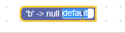

# 校验器

校验器是一个接收字段新值并执行处理的函数。它是定制字段的简单方式，可在字段值变化时触发功能、修改输入，或限制可接受值。

常见示例：

- 限制文本字段只能输入字母。
- 要求文本字段不能为空。
- 要求日期必须在未来。
- 根据下拉菜单值修改块形状。

::: tip 提示
校验器修改的是字段的[值而不是文本](/guides/create-custom-blocks/fields/anatomy-of-a-field#值)。
:::

## 校验器类型

不同类型的校验器触发时机不同。

**类校验器**是字段类型类定义的一部分，通常用于限制字段允许的值类型（例如数字字段只接受数字字符）。类校验器会对传给字段的所有值执行校验，包括构造函数中的初始值。

关于类校验器，见[创建自定义字段中的实现类校验器](/guides/create-custom-blocks/fields/customizing-fields/creating#实现类校验器)。

**本地校验器**在字段构造时定义。本地校验器会对传给字段的所有值执行校验，但不包括构造函数中的初始值。也就是说，它会对以下值运行：

- XML 中的值。
- 传给 `setValue` 的值。
- 传给 `setFieldValue` 的值。
- 用户交互修改后的值。

类校验器会先于本地校验器执行，作用类似守门，先确保值类型正确再继续传递。

关于值校验顺序和值本身，见[字段解析中的值](/guides/create-custom-blocks/fields/anatomy-of-a-field#值)。

## 注册本地校验器

本地校验器有两种注册方式：

- 直接作为字段构造函数参数传入。

::: tip 提示
字段构造函数签名会因字段类型而不同。
:::

```javascript
Blockly.Blocks['validator_example'] = {
  init: function() {
    // Remove all 'a' characters from the text input's value.
    var validator = function(newValue) {
      return newValue.replace(/\a/g, '');
    };

    this.appendDummyInput()
        .appendField(new Blockly.FieldTextInput('default', validator));
  }
};
```

- 使用 [`setValidator`](https://developers.google.com/blockly/reference/js/blockly.field_class.setvalidator_1_method)。

```javascript
Blockly.Blocks['validator_example'] = {
  init: function() {
    // Remove all 'a' characters from the text input's value.
    var validator = function(newValue) {
      return newValue.replace(/\a/g, '');
    };

    var field = new Blockly.FieldTextInput('default');
    field.setValidator(validator);

    this.appendDummyInput().appendField(field);
  }
};
```

上述任一方式都可封装进[扩展](/guides/create-custom-blocks/define/extensions)以支持 JSON 格式。

字段值的类型会因字段而异（例如数字字段存数字，文本输入字段存字符串），所以在编写校验器前应先阅读该字段文档。

::: tip 提示
只有可编辑字段支持校验器。
:::

## 返回值

校验器返回值决定字段下一步行为，共三种情况：

### 修改后的返回值

返回修改后的值或另一个值，该值将成为字段新值。常用于清理输入，例如去除尾随空格。

示例：

```javascript
// Remove all 'a' characters from the text input's value.
var validator = function(newValue) {
  return newValue.replace(/\a/g, '');
};
```


### 返回 `null`

返回 `null` 表示值无效。多数情况下字段会忽略该输入值。具体行为由字段的 `doValueInvalid_` [处理逻辑](/guides/create-custom-blocks/fields/customizing-fields/creating#处理无效值)决定。

示例：

```javascript
// Any value containing a 'b' character is invalid.  Other values are valid.
var validator = function(newValue) {
  if (newValue.indexOf('b') != -1) {
    return null;
  }
  return newValue;
};
```



### 返回 `undefined`

返回 `undefined`（或不写返回语句）或直接返回输入值，表示输入值应成为字段新值。这类校验器通常用于充当变更监听器。

示例：

```javascript
// Log the new value to console.
var validator = function(newValue) {
  console.log(newValue);
};
```

注意：显示文本不一定反映字段的值。

## this 的值

在校验器内部，`this` 指向字段本身，而不是块。如果需要访问块，可调用 `getSourceBlock`。也可以用 [`bind`](https://developer.mozilla.org/en-US/docs/Web/JavaScript/Reference/Global_objects/Function/bind) 指定校验器执行上下文。

使用 `getSourceBlock` 的示例：

```javascript
Blockly.Blocks['colour_match'] = {
  init: function() {
    this.appendDummyInput()
        .appendField(new Blockly.FieldColour(null, this.validate), 'COLOUR');
    this.setColour(this.getFieldValue('COLOUR'));
  },

  validate: function(colourHex) {
    this.getSourceBlock().setColour(colourHex);
  }
};
```

使用 [`bind`](https://developer.mozilla.org/en-US/docs/Web/JavaScript/Reference/Global_objects/Function/bind) 的示例：

```javascript
Blockly.Blocks['colour_match'] = {
  init: function() {
    this.appendDummyInput()
        .appendField(
            new Blockly.FieldColour(null, this.validate.bind(this)), 'COLOUR');
    this.validate(this.getFieldValue('COLOUR'));
  },

  validate: function(colourHex) {
    this.setColour(colourHex);
  }
};
```
