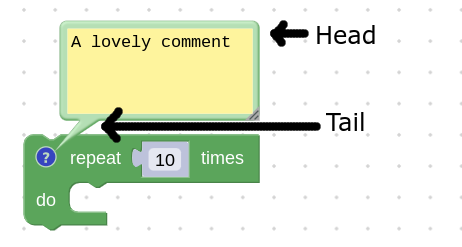

# 创建自定义气泡

气泡是一种弹出界面，外观类似漫画中的对话气泡。它有一个指向块的“尾部”，以及一个容纳任意 SVG 元素的“头部”。



如果内置气泡不满足需求，可以通过继承 `Bubble` 类创建自定义气泡。

## 创建视图

气泡视图就是气泡“头部”中的全部 SVG 元素。这些元素应在气泡构造函数中创建，并挂到 `this.contentContainer` 下，这样销毁气泡时可自动清理。

`Blockly.utils.dom` 模块提供了更简洁的 SVG 创建接口。

```javascript
class MyBubble extends Blockly.bubbles.Bubble {
  // See the Blockly.bubbles.Bubble class for information about what these
  // parameters are.
  constructor(workspace, anchor, ownerRect) {
    super(workspace, anchor, ownerRect);

    this.text = Blockly.utils.dom.createSvgElement(
          Blockly.utils.Svg.TEXT,
          {'class': 'my-bubble-class'},
          this.contentContainer);
    const node = Blockly.utils.dom.createTextNode('some text');
    this.text.appendChild(node);
  }
}
```

## 设置尺寸

需要通过 `setSize` 设置气泡尺寸，这样外框才能正确包裹内容。应在构造阶段设置，并在气泡内部界面元素尺寸变化时重新设置。

```javascript
constructor(workspace, anchor, ownerRect) {
  // Create the view elements... (see above)

  const bbox = this.text.getBBox();
  this.setSize(
    new Blockly.utils.Size(
      bbox.width + Blockly.bubbles.Bubble.BORDER_WIDTH * 2,
      bbox.height + Blockly.bubbles.Bubble.BORDER_WIDTH * 2,
    ),
    true
  );
}
```

## 释放气泡资源

气泡销毁时应清理 DOM 元素和外部引用。追加到 `this.contentContainer` 的元素会自动销毁，其他引用需要在 `dispose` 中手动清理。

```javascript
dispose() {
  super.dispose();

  // Dispose of other references.
  this.myArbitraryReference.dispose();
}
```
