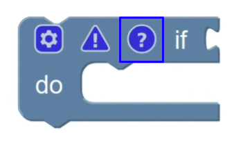

# 覆盖注释图标

你可以覆盖内置注释图标。例如，你可能希望注释的[弹出气泡](https://developers.google.com/blockly/guides/create-custom-blocks/icons/creating-custom-icons/use-bubbles)使用不同的展示方式。



要覆盖注释图标，需要继承 `CommentIcon`，重写 `ICommentIcon` 中的部分方法，并注册你的新图标。

::: tip 提示
Blockly 内置有三类图标：注释、警告、变形器。只有注释图标支持覆盖。
:::

## 继承 CommentIcon

先从继承 `CommentIcon` 开始：

```javascript
class MyCommentIcon extends Blockly.icons.CommentIcon {
  constructor(sourceBlock) {
    super(sourceBlock);
  }
}
```

## 重写 ICommentIcon 与 Icon 中的方法

为了定制图标，可以重写 `ICommentIcon` 中的方法（下文会分别说明），也可以重写 `Blockly.icons.Icon` 中的方法（见[创建自定义图标](/guides/create-custom-blocks/icons/creating-custom-icons/basic-implementation)）。

不要重写 `getType`，它必须返回 `Blockly.icons.IconType.COMMENT`。

### 文本

`ICommentIcon` 要求注释图标必须有文本。`getText` 需要返回注释文本，`setText` 需要设置文本并更新相关视觉表现。

```javascript
getText() {
  return this.text;
}

setText(text) {
  this.text = text;
  this.myRenderMethod();
}
```

### 气泡

你的自定义注释图标必须实现 `IHasBubble` 接口以支持序列化。即使你的图标技术上没有气泡，也建议在类上保存可见性状态，这样加载存档时不会丢失“注释是否打开”的信息。

```javascript
bubbleIsVisible() {
  return this.bubbleVisible;
}

setBubbleVisible(visible: boolean) {
  this.bubbleVisible = visible;
}
```

关于气泡，见 [Use pop-up bubbles](https://developers.google.com/blockly/guides/create-custom-blocks/icons/creating-custom-icons/use-bubbles)。

`ICommentIcon` 还要求实现 `getBubbleSize` 和 `setBubbleSize`。同样，即使没有真实气泡，也建议保存该状态以保持序列化一致性。

```javascript
getBubbleSize() {
  return this.bubbleSize;
}

setBubbleSize(size) {
  this.bubbleSize = size;
  this.myRenderMethod();
}
```

`ICommentIcon` 还要求实现 `getBubbleLocation` 和 `setBubbleLocation`，用于读写气泡在工作区中的位置。

```javascript
setBubbleLocation(location) {
  this.bubbleLocation = location;
}

getBubbleLocation() {
  return this.bubbleLocation;
}
```

### 保存和加载

你的自定义注释图标必须实现 `ISerializable` 接口。状态结构应符合 `CommentState`。

```javascript
saveState() {
  return {
    text: this.text,
    pinned: this.bubbleVisible,
    height: this.bubbleSize.height,
    width: this.bubbleSize.width,
    x: this.bubbleLocation.x,
    y: this.bubbleLocation.y,
  }
}

loadState(state) {
  this.setText(state.text);
  this.setBubbleVisible(state.pinned);
  this.setBubbleSize(new Blockly.utils.Size(state.width, state.height));
  this.setBubbleLocation(new Blockly.utils.Coordinate(state.x, state.y));
}
```

关于图标序列化，见 [Save and load icons](https://developers.google.com/blockly/guides/create-custom-blocks/icons/creating-custom-icons/save-and-load)。

## 注册你的图标

最后，先注销原有注释图标，再注册你的注释图标，让 Blockly 能实例化你的实现。注销使用字符串 `'comment'`，注册使用 `IconTypes.COMMENT`。

```javascript
Blockly.icons.registry.unregister('comment');
Blockly.icons.registry.register(Blockly.icons.IconType.COMMENT, myCommentIcon);
```

注册后，Blockly 会用你的图标替代内置注释图标。比如用户在右键菜单点击 “Add Comment” 时，或调用 `myBlock.setCommentText()` 时，都会使用新图标实现。
